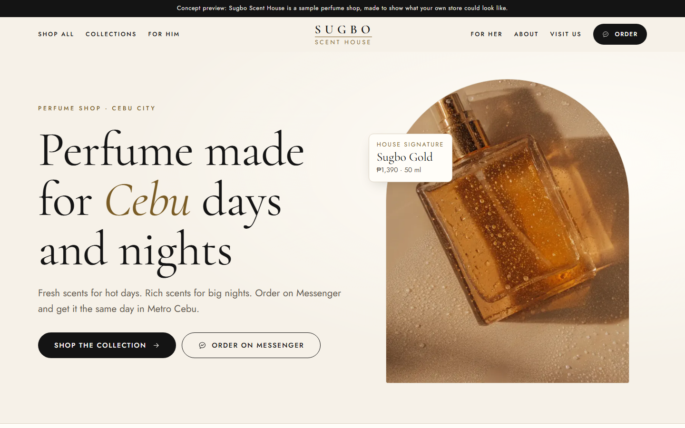
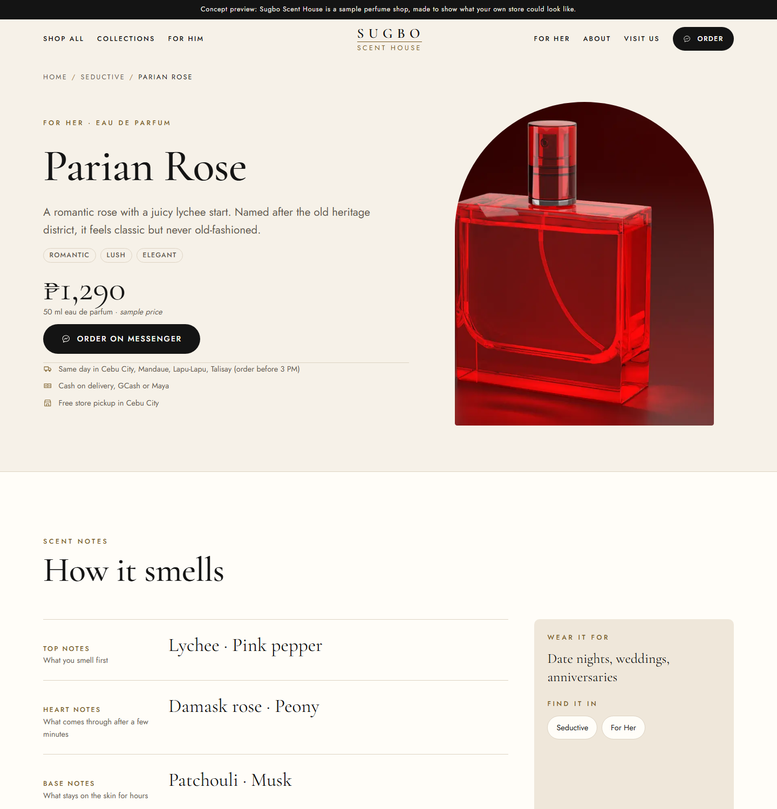
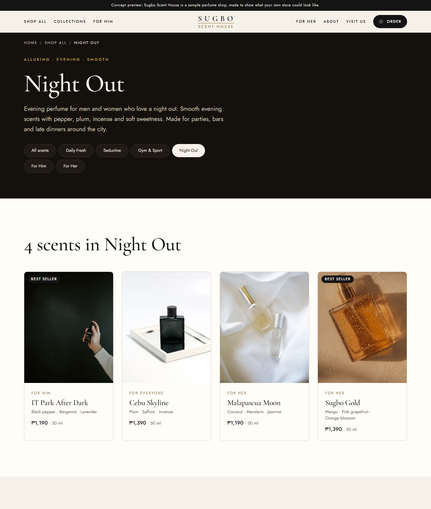
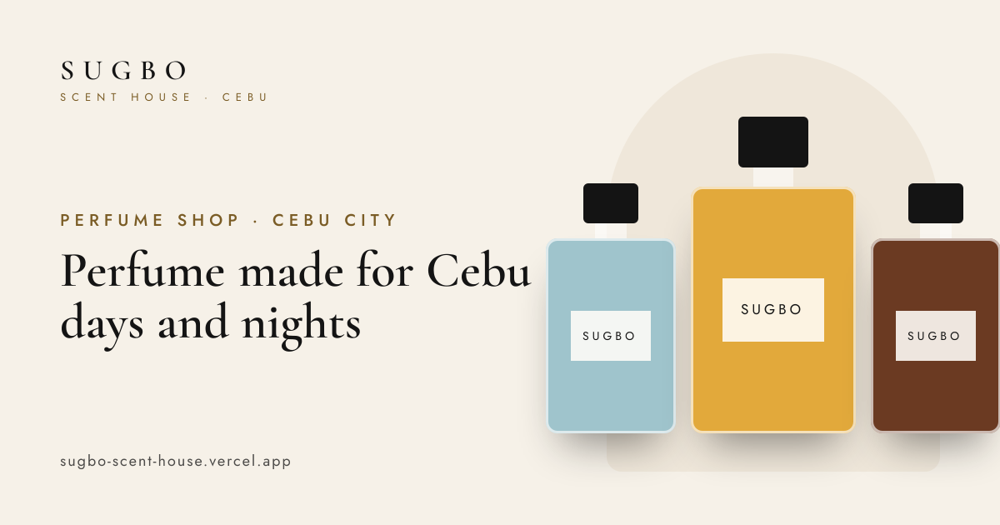

# Sugbo Scent House: concept perfume store

A **concept website** for a local perfume shop in **Cebu City, Philippines**. It shows a small
perfume business what its own online store could look like: browse by mood, read the scent notes,
and order with one tap on Messenger.

**Live preview: [sugboscenthouse.mactandigital.com](https://sugboscenthouse.mactandigital.com/)**

> **This is a concept, not a real shop.** "Sugbo Scent House" is a made-up brand. All scents,
> prices and contact details are samples. No real perfume brands, bottles or "inspired by"
> names are used. The site tells search engines not to list it (`noindex`).



## What's inside

- **Shop by mood**: Daily Fresh, Seductive, Gym & Sport and Night Out, plus For Him and For Her.
- **16 sample scents**, each with its own page: top, heart and base notes, mood words,
  what to wear it for, sample peso price and related scents.
- **Order on Messenger**: every product has a button that opens a chat with the order
  message already typed. In concept mode it shows a preview pop-up instead.
- **Made for Cebu**: same-day delivery in Cebu City, Mandaue, Lapu-Lapu and Talisay; cash on
  delivery, GCash and Maya; free store pickup; nationwide shipping.
- **Real photos** from Unsplash. Plain, unbranded bottles plus Cebu scenery (credited on the About page).
- **Pages:** Home, Shop All, 6 collection pages, 16 product pages, About, Visit Us and a custom 404.

| Product page | Collection page |
|---|---|
|  |  |

## Built in

- **SEO:** unique titles and descriptions, canonical links, sitemap, robots, one focus
  keyphrase per page, visible breadcrumbs.
- **Structured data (JSON-LD):** Organization, WebSite, Store, Product, CollectionPage,
  BreadcrumbList and FAQPage.
- **Social sharing:** Open Graph and X (Twitter) tags, with a generated 1200×630 share image
  for every page.

  

- **Accessible:** skip link, one H1 per page, visible focus rings, keyboard-friendly menu
  and FAQ, alt text on every photo, respects "reduce motion". Lighthouse accessibility: 100.
- **Mobile first:** tested from 320px up, 44px tap targets, sticky "Order" bar on phones.
- **Fully static:** no database, no backend. All content lives in typed files in `src/content/`.
- **Theme tokens:** colours, fonts, sizes and spacing are set once and used everywhere.
  Four ready-made looks: cream (default), noir, blush and sea.
- **Vercel Analytics and Speed Insights** (start reporting once deployed on Vercel).

## Tech

- [Next.js 16](https://nextjs.org) (App Router, Cache Components) + React 19 + TypeScript
- Plain CSS with CSS Modules and design tokens (no UI framework, no Tailwind)
- `next/font` (Cormorant Garamond + Jost), `next/image`, `next/og`

## Getting started

Needs **Node.js 20.9 or newer**.

```bash
npm install
npm run dev
```

Open http://localhost:3000.

| Command | What it does |
|---|---|
| `npm run dev` | Start the local dev server |
| `npm run build` | Build the production site |
| `npm start` | Serve the production build |
| `npm run lint` | Check the code |
| `npm run todos` | List the content still to fill in for a real client |
| `npm run check:assets` | Check image files (missing, too big, wrong shape) |
| `npm run check:links` | Crawl the running site (`npm start`, port 3000) for broken links, missing anchors, orphan pages and duplicate titles |

## Make it your own

| To… | Edit |
|---|---|
| Change the shop name, phone, email, hours, Messenger username | `src/content/site.ts` |
| Change scents, notes and prices | `src/content/products.ts` |
| Change collections and their copy | `src/content/collections.ts` |
| Change home page copy | `src/content/home.ts` |
| Reorder or hide home sections | `src/config/sections.ts` |
| Add a page to the menu and sitemap | `src/content/navigation.ts` |
| Turn concept mode / noindex / mobile bar on or off | `src/config/features.ts` |
| Change colours and the theme preset | `src/styles/tokens.css` + `features.theme` |
| Change fonts | `src/lib/fonts.ts` |
| Swap photos and credits | `public/images/` + `src/content/photos.ts` |
| Add a contact form (Tally, Typeform, Google Forms…) | `src/components/sections/FormEmbed.tsx` |

**Going live for a real shop:** set `conceptMode: false` and `indexable: true` in
`src/config/features.ts`, fill in every item from `npm run todos`, add the shop's Messenger
username, and set `NEXT_PUBLIC_SITE_URL` to the live domain.

## Project structure

```
src/
  app/          pages, sitemap, robots, share images
  components/   layout (header, footer, page shell), sections, UI kit
  config/       home section order, feature switches
  content/      all copy, scents, collections, photos (typed)
  lib/          SEO, structured data, fonts, share-image renderer
  styles/       design tokens (the only place colours live)
public/images/  photos (see public/images/README.md)
scripts/        TODO list, asset check, link crawl
```

## Deploy

1. Import the repo in [Vercel](https://vercel.com/new).
2. Add your domain in Vercel and set the environment variable `NEXT_PUBLIC_SITE_URL` to it
   (for example `https://example.com`). Without it, the site uses the address in `src/content/site.ts`
   (currently `https://sugboscenthouse.mactandigital.com`).
3. Deploy, then turn on **Web Analytics** and **Speed Insights** in the Vercel project.
4. Check the share preview with the [Facebook Sharing Debugger](https://developers.facebook.com/tools/debug/) ("Scrape Again").

The site can be shown inside an iframe on `mactandigital.com`. Change the allowed sites in
`next.config.ts` (`FRAME_ANCESTORS`).

## Photo credits

All photos are from [Unsplash](https://unsplash.com) under the free
[Unsplash License](https://unsplash.com/license). The bottles are plain sample props, not
Sugbo products, and carry no brand names.

| Used for | Photographer |
|---|---|
| Mactan Tide, Our story | [Fulvio Ciccolo](https://unsplash.com/@scentspiracy) |
| Lahug Morning | [Akhilesh Sharma](https://unsplash.com/@fotonium) |
| Tops Breeze, Parian Rose | [Muhammad Sulyman](https://unsplash.com/@msulyman) |
| Bantayan Linen | [Kier in Sight Archives](https://unsplash.com/@kierinsightarchives) |
| Colon Street Oud | [Sixteen Miles Out](https://unsplash.com/@sixteenmilesout) |
| Sinulog Ember | [Rae Wallis](https://unsplash.com/@raewallis) |
| Fuente Noir | [Jacob Padilla](https://unsplash.com/@jacob17pad) |
| Osmeña Peak Rush, For Him | [Ubaid E. Alyafizi](https://unsplash.com/@thehalaldesign) |
| Kawasan Splash | [Davit Margaryan](https://unsplash.com/@davitmarg) |
| Moalboal Blue | [Content Pixie](https://unsplash.com/@contentpixie) |
| Busay Green | [Maria Lupan](https://unsplash.com/@luandmario) |
| IT Park After Dark | [Apothecary 87](https://unsplash.com/@apothecary87) |
| Cebu Skyline | [Benjamin Watterson](https://unsplash.com/@wattersonboi) |
| Malapascua Moon | [Kailey Sniffin](https://unsplash.com/@kaisniffin) |
| Sugbo Gold, Hero | [Simply Mersah](https://unsplash.com/@simplymersah) |
| Daily Fresh (Tabuelan, Cebu) | [Josh Roland](https://unsplash.com/@jooot) |
| Seductive | [Mae Mu](https://unsplash.com/@picoftasty) |
| Gym & Sport | [Sara Ruffoni](https://unsplash.com/@ssarasframes) |
| Night Out (Cebu City) | [Ken Suarez](https://unsplash.com/@kensuarez) |
| About and Visit pages (Cebu City) | [BRYNLLD](https://unsplash.com/@brynlld) |

Each photo's source page is linked in `src/content/photos.ts`.

## Licence

No open-source licence has been added to the code yet, so all rights are reserved by the
author. Photos stay under the [Unsplash License](https://unsplash.com/license). Fonts are
from Google Fonts under the SIL Open Font License.

---

Designed and built by [Mactan Digital](https://www.mactandigital.com).
